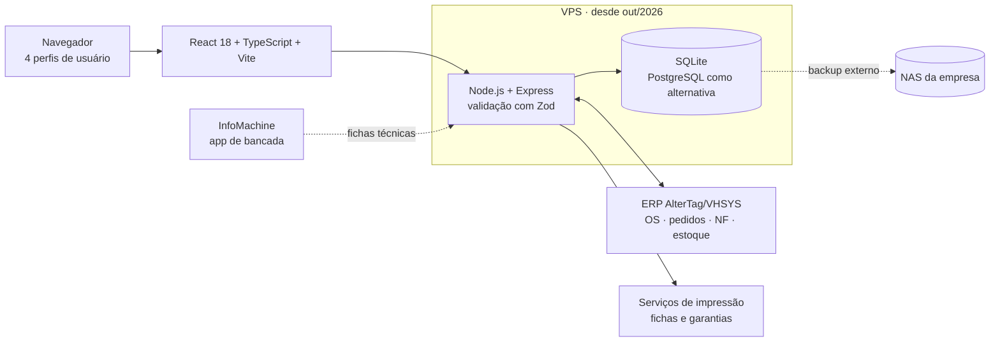

# InfoCAIJ · estudo de caso

**Como uma operação de venda e preparação de notebooks saiu do WhatsApp para um sistema rastreável, desenvolvido e mantido por uma pessoa.**

> O InfoCAIJ é um sistema interno da CAIJ Informática e seu código é privado. Este repositório documenta o problema, as decisões e os resultados, sem dados de clientes, credenciais ou detalhes de infraestrutura.

| Número | Contexto |
|--:|:--|
| **~300** | máquinas e pedidos por mês passam pelo sistema |
| **15 contas · 4 perfis** | administração, técnicos, vendedores e estoque |
| **8 etapas** | da venda à entrega, cada uma com responsável e horário registrados |
| **13 mil+** | eventos de histórico operacional registrados |
| **1** | desenvolvedor, de junho de 2026 até hoje |

<!-- Adicione 2 ou 3 capturas em docs/ com dados fictícios ou borrados (fila da bancada, dossiê por serial, Modo TV). -->

## O problema

As vendas chegavam por mensagem, no formato "4 notebooks do modelo X, 2 do modelo Y". A bancada preparava as máquinas, tirava foto da ordem de serviço e mandava ao vendedor pelo WhatsApp. Funcionava enquanto o volume era pequeno, mas cada pergunta simples exigia reconstruir a história:

- Qual máquina física atendeu cada unidade vendida?
- Quem está com ela agora e o que falta para ficar pronta?
- Qual OS, qual pedido e qual nota fiscal pertencem a essa serial?
- O que aconteceu quando ela voltou numa devolução?

Uma venda de "4 notebooks" são quatro máquinas diferentes, com seriais, testes e históricos próprios. Registrar só a quantidade não resolvia a rastreabilidade.

## A solução

Cada unidade vendida vira um item com identidade própria e percorre uma fila compartilhada:

Em volta dessa fila, o sistema cresceu para cobrir o ciclo de vida do equipamento:

- **Checklist técnico** de 10 verificações (liga, tela, teclado, touchpad, Wi-Fi, som, USB, bateria, carregador e sistema), cada uma aprovada, reprovada ou não testada.
- **Integração com o ERP AlterTag/VHSYS** para consultar OS, pedidos, notas fiscais, catálogo e estoque, com preenchimento automático da serial a partir da OS.
- **Lotes e estoque**, com importação de planilhas e prévia antes de gravar, separando modelo, configuração, lote, patrimônio, serial e localização.
- **Dossiê por serial**, que reúne lote, vendas, pedido, nota, garantia e eventos de uma máquina, inclusive quando ela é vendida mais de uma vez.
- **Devoluções e revenda**, com estado comercial separado do estado técnico, motivo obrigatório e bloqueio de duas vendas ativas para a mesma serial.
- **Garantias com QR Code** de 3, 6 ou 12 meses, ligadas à identidade do equipamento.
- **Dashboard e Modo TV**, com alertas de máquinas novas, prontas e aguardando embalagem.

## Arquitetura

O domínio (vendas, itens, unidades, lotes, garantias, pedidos e movimentações) é tipado e compartilhado entre interface e servidor.

## Decisões que valeram a pena

**Quantidade vira unidade logo na entrada.** Transformar "4 notebooks" em quatro itens no momento da venda é o que torna possível perguntar "quem está com esta máquina" depois.

**Estado técnico e estado comercial são coisas diferentes.** Uma máquina pode estar "entregue" na bancada e "devolvida" no comercial. Separar os dois ciclos evitou regras contraditórias e preservou o histórico em revendas.

**Respostas antigas do ERP são descartadas.** A consulta da OS dispara 400 ms depois que a pessoa para de digitar, e uma resposta que chega depois de a OS mudar não sobrescreve a atual.

**Saldo atual não é histórico.** Na conciliação com o ERP, uma entrada antiga de estoque não pode aparecer como máquina disponível hoje. A captura de outubro de 2026 trouxe 8.207 movimentações de 408 produtos, comparadas por serial, com os casos ambíguos separados para revisão manual em vez de resolvidos por palpite.

**Migração com caminho de volta.** A saída do computador local para uma VPS, em 14/10/2026, teve cópia consistente do banco, conferência de hash, ambiente de teste, plano de retorno e trava contra dois servidores gravando ao mesmo tempo.

## Qualidade

- 95 arquivos de teste (Vitest, Testing Library e Supertest) cobrindo interface, API, importação, regras de estoque, ciclo comercial, garantias e permissões.
- Documentos de requisitos, decisões, operação, backup e migração escritos junto com o código.
- Commits no padrão Conventional Commits, com revisão antes de integrar à `main`.

## Como a IA entrou no desenvolvimento

Desenvolvi o sistema com apoio de assistentes de código. A IA acelerou implementação e testes; o levantamento com a operação, as regras de negócio e a validação de cada mudança no uso real ficaram comigo.

## O que ainda não está medido

Não há medição formal de tempo antes e depois. O que mudou de forma verificável foi o processo: consultas que dependiam de mensagens e fotos passaram a ter um registro único por máquina. O próximo passo é medir o tempo entre etapas da fila, que o próprio sistema já registra.

## Próximos passos

- Concluir a camada própria de movimentações de estoque como fonte única da verdade.
- Medir o tempo entre etapas e a taxa de correções de serial.
- Usar um LLM para extrair dados estruturados das descrições livres de hardware que chegam nas planilhas de lote, com validação de esquema e taxa de acerto medida antes de entrar em produção.

---

Vitor Tosti · [LinkedIn](https://www.linkedin.com/in/vitortosti/) · [GitHub](https://github.com/VitorTosti)
